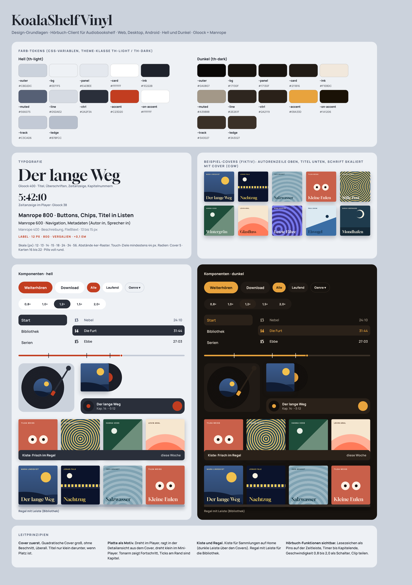

# KoalaShelf

Eigener Client für einen [Audiobookshelf](https://www.audiobookshelf.org)-Server (Hörbücher): Web-App (PWA), Desktop (Tauri) und native Android-App.
Der Server bleibt unverändert, KoalaShelf ersetzt nur die Oberfläche. Design: „KoalaShelf Vinyl“.

## Status

Phase 1: Planung. Siehe [docs/plan.md](docs/plan.md).

## Dokumente

- [Briefing](docs/briefing.md)
- [Plan, Stack, Struktur, Phasen](docs/plan.md)
- [Geprüfte API-Notizen](docs/abs-api-notes.md)
